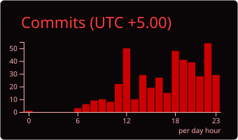
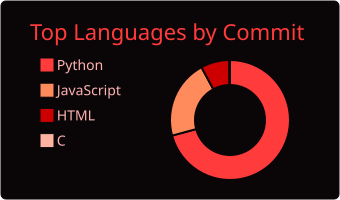

 

I'm **L4ZZ3RJ0D** (Sree Danush S), a security researcher from Tamil Nadu, India. I build my own tools for web bug hunting and OSINT, and I like breaking AI/LLM apps. Founder of **Project Hellhound** and co-founder of **TriOps Security**.

  
More about me

- **Name**: Sree Danush S
- **From**: Tamil Nadu, India
- **Focus**: Web security, OSINT, AI/LLM security
- **Founder**: Project Hellhound (open-source security tools)
- **Co-founder**: TriOps Security
- **Building**: Autonomous tools for bug hunting and recon
- **Writing**: CTF and security writeups on Medium, link at the top

 

▸ Hunting web bugs on HackerOne and SignalFisher, sharpening it on PortSwigger Academy and TryHackMe

▸ Building Bounty Hunter and JARVIS at Project Hellhound, the org I founded

▸ Writing up what I learn on Medium

 

Freelance or full-time work in:

▸ **Web application pentesting**

▸ **OSINT**

▸ **AI / LLM pentesting** (including vision-LLM attacks)

 

| Project | What it does | Stars |
|:--------|:-------------|:------|
|  | Web crawler that maps endpoints, parameters and attack surface on traditional and SPA apps |  |
|  | AI-driven bug bounty framework, recon to report, with strict scope guardrails |  |
|  | Command injection detector that escalates from direct output to blind and OOB checks |  |
|  | OSINT and personal assistant: username scans, domain mapping, live flight tracking |  |

 

 

 

 

  

  

 

  <b><i>"Automate the boring attacks. Perfect the creative ones."</i></b>

